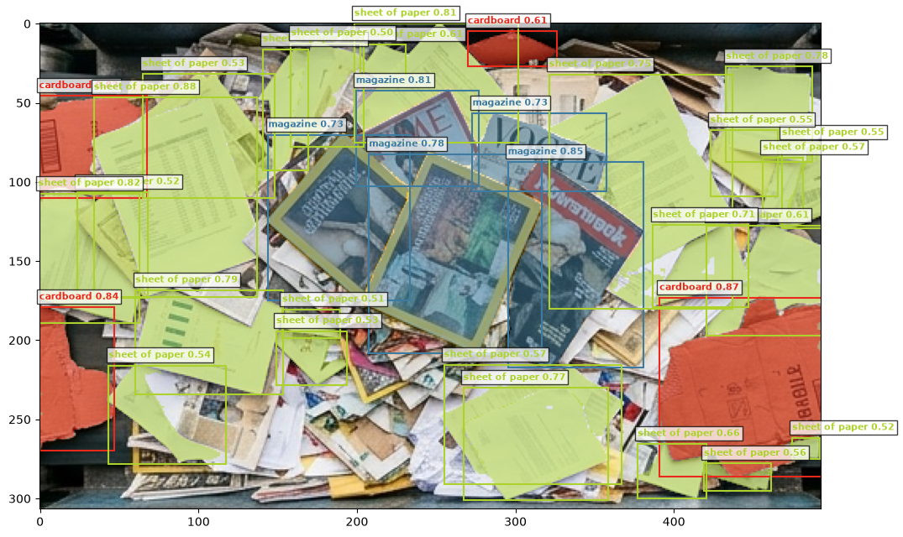

# pytorch-detector-playground

Playground for testing object detectors on conveyor-belt images. SAM 3 (text-prompted segmentation) is the first model under test.

## Requirements

uv installs the Python dependencies. These are not managed by uv:

- **SAM 3 source checkout** next to this repo, at `../sam3`. `pyproject.toml` installs it in editable mode from that path.
  ```
  git clone https://github.com/facebookresearch/sam3.git ../sam3
  ```
- **SAM 3 weights.** The [facebook/sam3](https://huggingface.co/facebook/sam3) checkpoint on Hugging Face is gated. Request access on the model page, then log in once with `uv run hf auth login`. The first run downloads the weights to `~/.cache/huggingface`.
- **NVIDIA GPU with CUDA.** torch comes from the CUDA 12.8 wheel index. Inference runs in bfloat16 on `cuda`. Tested on an 8 GB laptop GPU.
- **Tk** for the CLI plot window: `sudo apt install python3-tk`. Without it, matplotlib cannot open a window.

## Usage

Run commands from the repository root.

```
uv sync
uv run pytest                                                    # acceptance tests
uv run python -m detector_playground.cli data/samples/conveyor_3.jpg cardboard magazine "sheet of paper"
```

The CLI prints the detection count per prompt and plots each prompt's masks and boxes in one colour:


